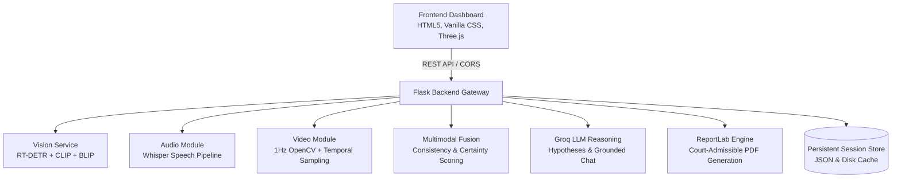

# CrimeVision AI – Intelligent Multimodal Forensic Analysis Platform

**CrimeVision AI** is an advanced forensic intelligence platform designed to automate crime scene reconstruction and digital evidence analysis using multimodal artificial intelligence. By integrating **image, video, and audio evidence**, the system identifies people, weapons, and objects, analyzes tactical actions, transcribes multilingual witness statements, and generates unified chronological forensic timelines with 3D spatial scene reconstruction.

---
.
## 🏛️ System Architecture



---

## 🎯 Key Milestones & Capabilities

### Milestone 1: Initialization & Environment
- Production-grade dependency management with PyTorch, OpenCV, Transformers, Accelerate, ReportLab, and Groq SDK.
- Zero-crash fallback mechanisms for edge and offline forensic deployments.

### Milestone 2: Image Analysis & 3D Spatial Reconstruction
- **Object Detection (RT-DETR)**: Detects suspects (mapped as `Human`), weapons (`knife`, `gun`), furniture, laptops, and forensic markers with confidence scores.
- **Scene Classification (CLIP)**: Zero-shot environmental classification (Office, Store, Road, Bedroom, etc.).
- **Visual Captioning & Summarization (BLIP / Groq)**: Professional two-line structured forensic summaries (`Summary Type` + `Brief Description`).
- **Interactive 3D Scene Reconstruction (Three.js)**: Projects 2D detections into a 3D coordinate frame `[x, y, z]` with orbit camera controls, wireframe bounding boxes, and evidence markers.

### Milestone 3: Audio Analysis & Multilingual Witness Statements
- **Speech-to-Text (Whisper Pipeline)**: High-accuracy segment transcription with millisecond-accurate timestamps.
- **Multilingual Support**: Interactive localization tabs across **English, Hindi, Telugu, and French**.
- **Forensic Fact Mining**: Automated zero-shot extraction of "Who, Where, and When" facts, suspect profiles, and acoustic location cues.

### Milestone 4: Video Analysis & Chronological Timelines
- **1Hz Dual-Pipeline Sampling**: Frame-by-frame extraction via OpenCV preserving evidentiary aspect ratios.
- **Crime Classification**: Probabilistic categorization into crime types (e.g., `NORMAL ACTIVITY (90%)`, `ARMED ROBBERY (95%)`).
- **Interactive Second-by-Second Event Timeline**: Synchronized table where clicking any timestamp jumps video playback directly to that second.

### Milestone 5: Multimodal Fusion & Intelligence Generation
- **Cross-Modal Consistency Auditing**: Cross-corroborates audio witness statements with visual detections and assigns certainty scores.
- **Scenario Hypothesis Generation**: Generates 3 distinct models via Groq:
  1. *Primary Scenario (Most Likely)*
  2. *Alternative Scenario (Defensive)*
  3. *Low-Probability Scenario (Outlier / Staged)*
- **Context-Aware Evidence Chatbot**: RAG-grounded question answering with direct Regex temporal parsing (`who was there at 5s?`) and low-temperature deterministic answers.

### Milestone 6: Interface, Automated PDF Reports & Verification
- **Dark Forensic Dashboard**: Streamlined UI matching the specification.
- **Automated PDF Reports**: High-resolution, multi-page forensic reports compiled via ReportLab including evidence catalogs, timelines, scenario models, and hash validation.
- **Complete Test Suite**: Unit and integration tests in `backend/tests/test_validation.py`.

---

## 🚀 Quick Start Guide

### 1. Requirements
Ensure Python 3.9+ is installed:
```bash
python --version
```

### 2. Install Dependencies
```bash
pip install -r backend/requirements.txt
```

### 3. Configure Environment Variables (Optional for Groq LLM)
Create or edit `backend/.env`:
```env
GROQ_API_KEY=your_groq_api_key_here
GROQ_MODEL=llama-3.3-70b-versatile
PORT=5000
```
*(Note: If no API key is provided, CrimeVision AI automatically utilizes its built-in forensic heuristic engine so the dashboard and tests remain 100% operational).*

### 4. Run Validation Tests
Verify system integrity:
```bash
python -m unittest backend/tests/test_validation.py
```

### 5. Launch Application
Start the Flask forensic server:
```bash
python backend/app.py
```
Open your browser and navigate to:
```
http://localhost:5000
```

---

## 📡 REST API Documentation

| Endpoint | Method | Description |
|---|---|---|
| `/api/health` | `GET` | Health check, device, and CUDA acceleration status |
| `/api/process/image` | `POST` | Execute RT-DETR, CLIP, BLIP, and 3D projection on image |
| `/api/analyze-audio` | `POST` | Execute Whisper transcription, multilingual translations, and audio timeline |
| `/api/analyze-video` | `POST` | Execute 1Hz frame sampling, crime classification, and second-by-second timeline |
| `/api/process/complete/<case_id>` | `POST` | Full multimodal pipeline fusion across visual, audio, and video streams |
| `/api/chat/<mode>` | `POST` | Query forensic chatbot (`image`, `audio`, `video`) with context retrieval |
| `/api/report/download/<session_id>` | `GET` | Download court-admissible forensic PDF report |

---

## 👤 Project Author
- **Lead Developer**: Rahul Rajak
- **Platform**: CrimeVision AI Intelligent Multimodal Forensic Analysis Platform
